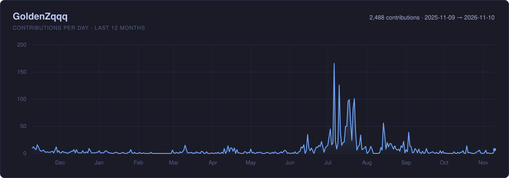

<h2 align="center">👋 Hey! I'm GoldenZqqq. 🚀</h2>

  

- 👋 Hi, I'm **GoldenZqqq** - A Frontend Engineer & Vibe Coder
- 💻 Proficient in **Next.js**, **React**, **Vue.js** and modern frontend tech stacks
- 🤖 Transitioning to AI Agent Engineering with **LangChain** and **LangGraph**
- 🚀 Exploring **Vibe Coding** and **Skills-based development**
- 🎨 Passionate about creating beautiful UIs with **Three.js** and modern design
- 🔭 Building full-stack AI applications: Next.js + LangChain
- 📫 Reach me: [zqqq1021@gmail.com]

 

---

## 📊 GitHub Stats & Activity

  

---

## 🎨 Frontend Development

  
  

### 💻 What I Do

- **⚛️ Modern Frameworks**: Building scalable applications with Next.js, React, and Vue.js
- **🎨 3D Graphics**: Creating immersive experiences with Three.js
- **🎯 TypeScript**: Writing type-safe, maintainable code
- **🚀 Performance**: Optimizing for speed and user experience
- **📱 Responsive Design**: Crafting beautiful UIs that work everywhere

---

## 🤖 Transitioning to AI Agent Engineering

  

### 🌱 Currently Exploring

- **🦜 LangChain & LangGraph**: Building agent workflows and state machines
- **🧠 RAG Systems**: Retrieval Augmented Generation with vector databases
- **🔄 Agentic Workflows**: Designing autonomous AI systems
- **🚀 AI-Native Development**: Leveraging v0.dev, Bolt.new for rapid prototyping

---

## 🎯 Vibe Coding & Skills

  
  

### 🛠️ AI Development Toolkit

    &nbsp;
    &nbsp;
    &nbsp;
    &nbsp;
    &nbsp;
    &nbsp;

---

##  Tech Stack 

    &nbsp;
    &nbsp;
    &nbsp;
    &nbsp;
    &nbsp;
    &nbsp;
    &nbsp;
    &nbsp;
    &nbsp;
    &nbsp;
    &nbsp;
    &nbsp;
    &nbsp;
    &nbsp;
    &nbsp;

---

## 🎯 Current Focus & Goals

  
  

### 🎯 Current Focus Areas
- **💻 Frontend Excellence**: Mastering Next.js, React, Vue.js and modern web technologies
- **🎨 Vibe Coding**: Embracing natural language programming and Skills-based development
- **🤖 AI Agent Learning**: Exploring LangChain & LangGraph for intelligent systems
- **🚀 Full-Stack AI Apps**: Combining frontend expertise with AI capabilities
- **🌐 Open Source**: Contributing to frontend and AI/Agent projects

---

  

  **Thanks for visiting my GitHub! Let's build amazing things together!** 🌟

